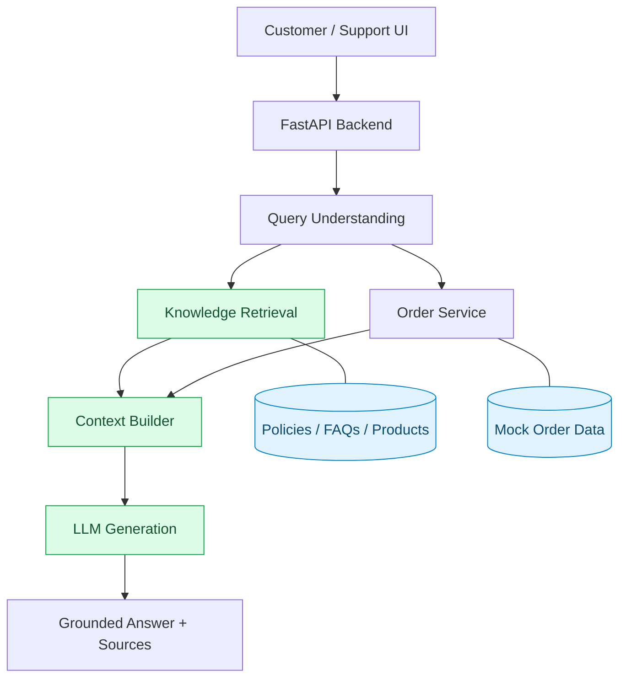

# AI Commerce Support Assistant

An AI-powered ecommerce support system built around semantic retrieval, Retrieval-Augmented Generation (RAG), and reliable access to ecommerce data.

The project focuses on building an accurate, secure, and scalable customer support assistant that answers questions using store knowledge and structured order information.

## Overview

Ecommerce support involves more than answering FAQs. Customer questions can require interpreting store policies, checking order information, handling ambiguous requests, and identifying situations that require human assistance.

This project explores how AI can support these workflows using evidence-based answers, controlled data access, and systematic evaluation.

## Architecture





The current implementation includes semantic retrieval and the FastAPI search endpoint. LLM generation and order-aware workflows are not yet implemented.

## Technology Stack

| Component | Technology |
|---|---|
| Backend | Python, FastAPI |
| Embeddings | Sentence Transformers |
| Embedding Model | all-MiniLM-L6-v2 |
| Similarity Search | NumPy, cosine similarity |
| Knowledge Base | Markdown documents |
| Testing | Pytest |
| LLM Integration | OpenAI Responses API (planned) |
| Frontend | Next.js, React, TypeScript (planned) |
| Deployment | Google Cloud Run, Vercel (planned) |

## Features

### Semantic Knowledge Retrieval

The system processes ecommerce knowledge documents and divides them into searchable sections using Markdown headings.

Each section is converted into a normalized vector embedding. Customer queries are embedded using the same model, and relevant sections are ranked by cosine similarity.

Retrieval results include the matching content, source document, section heading, chunk identifier, and similarity score.

### Ecommerce Knowledge Base

The initial knowledge base represents Northstar Goods, a fictional outdoor equipment retailer, and includes shipping, returns, cancellations, product information, and FAQs.

All store policies and products are demonstration data.

### Search API

**GET `/support/search`**

Example request:

```http
GET /support/search?q=How%20much%20does%20express%20shipping%20cost%3F&top_k=3
```

Example top-ranked result:

```json
{
  "id": "shipping-3",
  "source": "shipping.md",
  "heading": "Express Shipping",
  "text": "Express Shipping\nExpress shipping costs €9.90.\nEstimated delivery is 1–2 business days after dispatch.",
  "score": 0.7877
}
```

The API returns a JSON object containing the query and a list of ranked results.

### Automated Testing

The current test suite covers API health, retrieval accuracy for five representative queries, empty-query handling, result limits, and source metadata.

The initial validation passed all nine tests, with the expected source ranked first for all five sample retrieval questions.

This is a small initial test set rather than a comprehensive retrieval benchmark.

## Getting Started

### Requirements

- Python and pip
- Git

### Installation

```bash
git clone https://github.com/mausamthakrar/ai-commerce-support-assistant.git
cd ai-commerce-support-assistant

python3 -m venv .venv
source .venv/bin/activate

pip install -r requirements.txt
```

### Run the API

```bash
python -m uvicorn app.main:app --reload
```

API documentation: `http://127.0.0.1:8000/docs`

Health endpoint: `http://127.0.0.1:8000/health`

### Run Tests

```bash
python -m pytest -v
```

Check runtime warnings:

```bash
python -m pytest -W error::RuntimeWarning -v
```

## Engineering Focus

The broader implementation is designed to address realistic ecommerce support challenges, including multi-turn conversations, order-specific questions, ambiguous requests, conflicting information, customer data isolation, prompt injection, and controlled failure handling.

The knowledge pipeline will also be evaluated against significantly larger document collections, with attention to chunking, retrieval quality, indexing, latency, and document updates.

These are engineering objectives, not claims that the current implementation already supports these scenarios.

## License

No license has been selected.