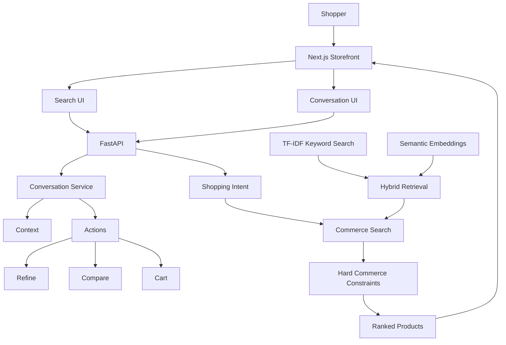
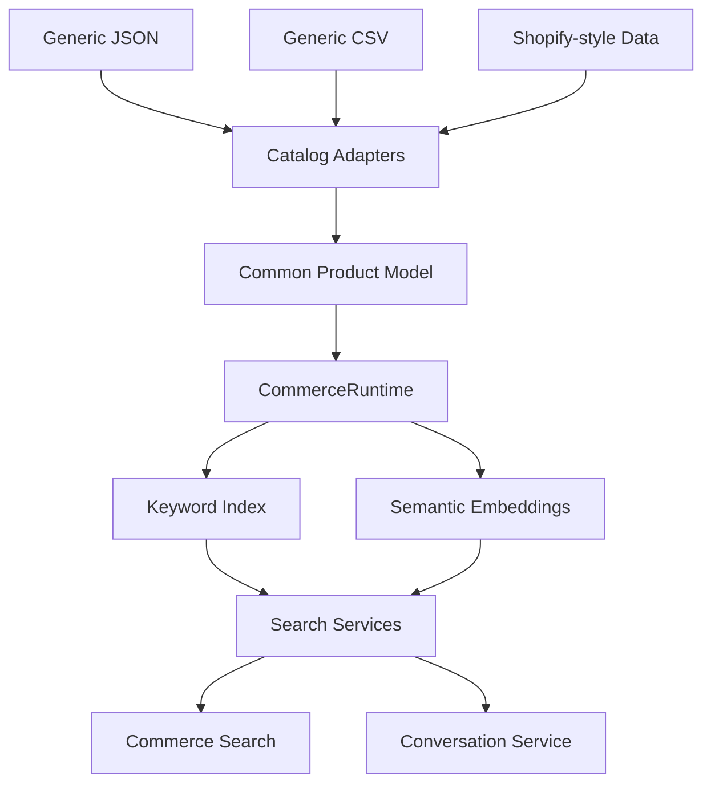
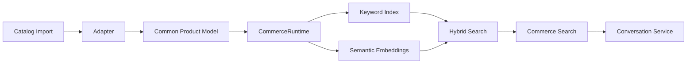
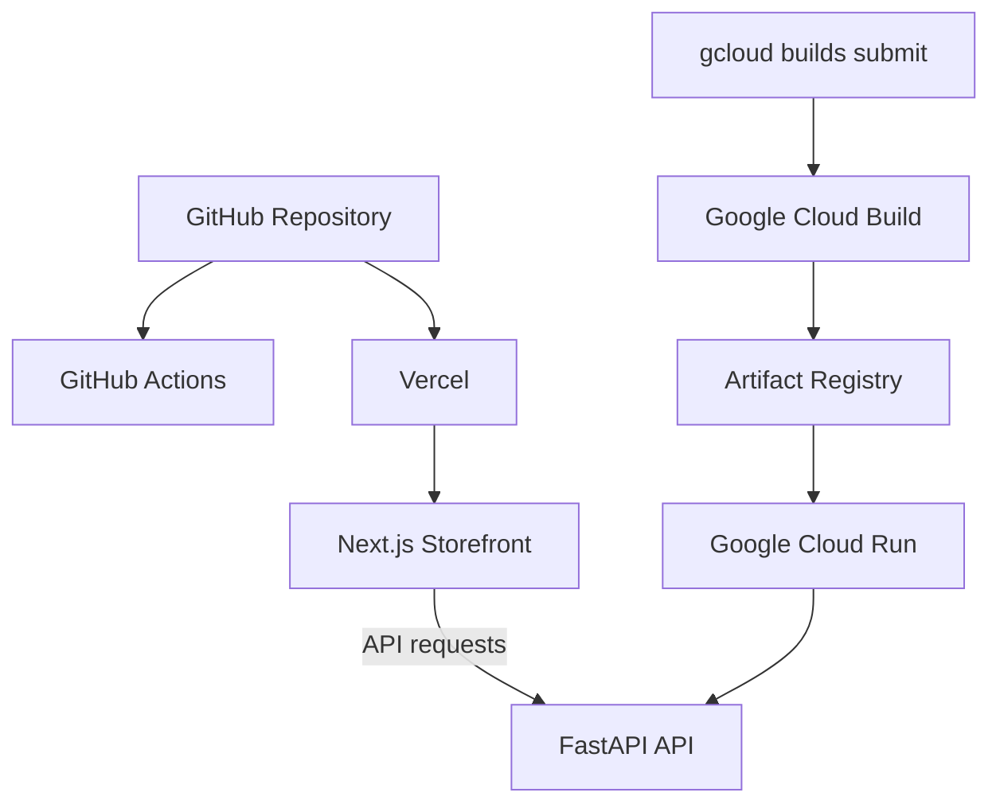

# AI Commerce Product Discovery

A conversational ecommerce product discovery system combining semantic retrieval, keyword search, deterministic commerce rules, conversational refinement, catalog adapters, and merchant configuration.

[**Live demo**](https://ai-commerce-product-discovery.vercel.app) · [**Merchant tools**](https://ai-commerce-product-discovery.vercel.app/merchant) · [**API docs**](https://ai-commerce-product-discovery-api-1017209097381.europe-west3.run.app/docs)


---

## Demo

### Product discovery


### Conversational refinement and comparison


### Conversational cart


### Merchant tools


---

## What it does

Instead of relying only on keywords and filters, shoppers can describe what they need in natural language.

For example:

```text
waterproof hiking shoes under €200
```

The application extracts structured shopping intent, retrieves relevant products, applies hard ecommerce constraints, and returns eligible results.

The shopper can then continue with the same context:

```text
only black ones
which is cheapest?
compare the first two
add the cheapest one to cart
```

The system supports:

- natural-language product search
- TF-IDF keyword retrieval
- semantic retrieval using sentence embeddings
- hybrid keyword + semantic ranking
- structured shopping-intent extraction
- price, category, brand, color and attribute constraints
- ambiguity detection and clarification
- conversational search refinement
- cheapest / most expensive queries
- ordinal product references
- structured product comparison
- conversational add-to-cart actions
- runtime catalog replacement
- merchant-controlled search configuration

Commerce operations such as price limits, availability, comparisons and cart selection are handled deterministically rather than relying on generated answers.

---

## Application architecture



The retrieval layer decides how relevant a product is.

Commerce constraints decide whether the product is eligible to appear at all.

For example, a semantically relevant €180 product cannot appear when the shopper explicitly asks for products under €120.

---

## Search and shopping intent

A query such as:

```text
black waterproof hiking shoes under €120
```

can be interpreted as:

```json
{
  "category": "trail-shoes",
  "brand": null,
  "min_price": null,
  "max_price": 120,
  "color": "black",
  "waterproof": true,
  "lightweight": null,
  "in_stock": null
}
```

The system also detects ambiguity.

For example:

```text
something light for walking through wet mountains
```

suggests properties such as:

```text
lightweight = true
waterproof = true
```

but does not clearly identify whether the shopper wants footwear, clothing, a backpack, or camping equipment.

In that case, the application requests clarification rather than returning an arbitrary semantic match.

---

## Hybrid retrieval

Keyword retrieval uses TF-IDF with unigram and bigram features.

Semantic retrieval uses:

```text
sentence-transformers/all-MiniLM-L6-v2
```

Product embeddings include information such as title, description, category, brand, tags and structured attributes.

The two retrieval signals are normalized and combined.

Default weighting:

```text
Semantic: 65%
Keyword:  35%
```

Merchants can change these weights at runtime.

---

## Catalog architecture

The discovery engine operates on a common internal product model rather than depending directly on a specific ecommerce platform.



Currently supported catalog inputs:

- Generic JSON
- Generic CSV
- Shopify-style JSON

Additional platforms can be supported by adding adapters that convert their product data into the common internal model.

The core retrieval and commerce logic does not need to change.

---

## Runtime catalog management

When a merchant imports a new catalog, the application rebuilds the product-dependent runtime.



The newly imported catalog becomes searchable immediately without restarting FastAPI.

The bundled demo catalog can also be restored from the merchant interface.

---

## Merchant tools

The merchant interface is available at:

https://ai-commerce-product-discovery.vercel.app/merchant

It provides:

- active catalog source
- product and inventory statistics
- category and brand overview
- JSON catalog import
- CSV catalog import
- Shopify-style catalog import
- demo catalog restoration
- maximum recommendation configuration
- semantic / keyword weighting
- unavailable-product visibility control

Search-weight updates do not rebuild the embedding index.

Catalog replacements do rebuild the services that depend on product data.

---

## API

The backend is built with FastAPI.

Interactive documentation:

https://ai-commerce-product-discovery-api-1017209097381.europe-west3.run.app/docs

Main endpoints:

| Endpoint | Purpose |
|---|---|
| `GET /health` | Application and catalog health |
| `GET /products` | Current runtime products |
| `GET /search` | Keyword retrieval |
| `GET /search/semantic` | Semantic retrieval |
| `GET /search/commerce` | Intent-aware commerce search |
| `POST /conversation` | Conversational shopping |
| `GET /merchant/catalog` | Catalog status |
| `POST /merchant/catalog/import` | Replace runtime catalog |
| `POST /merchant/catalog/reset` | Restore demo catalog |
| `GET /merchant/settings` | Read search configuration |
| `PUT /merchant/settings` | Update search configuration |

---

## Demo catalog

The bundled deterministic catalog contains 120 synthetic ecommerce products across:

```text
trail-shoes
hiking-jackets
backpacks
camping
```

Example import catalogs are included under:

```text
backend/data/import_examples/
```

```text
generic-products.json
generic-products.csv
shopify-products.json
```

---

## Deployment



### Frontend

Hosted on Vercel:

https://ai-commerce-product-discovery.vercel.app

### Backend

Hosted on Google Cloud Run.

The backend container is built with Google Cloud Build and stored in Google Artifact Registry.

The Cloud Run service is configured to scale to zero when idle.

---

## Running locally

### Docker

The simplest way to run the complete application:

```bash
docker compose build
docker compose up
```

Then open:

```text
Storefront
http://localhost:3000

Merchant tools
http://localhost:3000/merchant

API docs
http://localhost:8000/docs
```

Stop the application with:

```bash
docker compose down
```

### Without Docker

Backend:

```bash
python3.12 -m venv .venv
source .venv/bin/activate
pip install -r requirements.txt

cd backend
uvicorn app.main:app --reload
```

Frontend:

```bash
cd frontend
npm install
npm run dev
```

The frontend expects:

```env
NEXT_PUBLIC_API_BASE_URL=http://127.0.0.1:8000
```

---

## Tests and CI

Backend:

```bash
cd backend
python -m pytest
```

Current result:

```text
24 passed
```

The tests cover retrieval, commerce filtering, intent parsing, ambiguity handling, conversation flows, product comparison, cart selection, catalog adapters, runtime replacement and search configuration.

Frontend checks:

```bash
cd frontend
npm run lint
npm run build
```

GitHub Actions runs backend tests, frontend linting and the Next.js production build on pushes to `main` and pull requests.

---

## Technology

| Area | Technology |
|---|---|
| Backend | Python 3.12, FastAPI, Pydantic |
| Retrieval | scikit-learn, sentence-transformers, NumPy |
| Frontend | Next.js, React, TypeScript |
| Testing | pytest, ESLint, Next.js production build |
| Containers | Docker, Docker Compose |
| CI | GitHub Actions |
| Backend deployment | Google Cloud Build, Artifact Registry, Cloud Run |
| Frontend deployment | Vercel |

---

## Design decisions

### Separate relevance from commerce eligibility

Semantic relevance never overrides explicit shopper constraints such as price, inventory or product attributes.

### Use deterministic logic for deterministic commerce operations

Search constraints, comparison, ordinal references and cart selection are handled with structured logic.

### Keep the discovery engine platform-independent

External catalog formats are converted into a shared internal product model through adapters.

### Rebuild only what changed

Catalog replacement rebuilds product-dependent search services.

Ranking configuration changes do not recreate semantic embeddings.

---

## Current scope

This project is a portfolio implementation rather than a production commerce platform.

The current version intentionally does not include:

- persistent database storage
- user or merchant authentication
- production checkout
- persistent server-side carts
- live Shopify OAuth
- continuous Shopify catalog synchronization
- webhooks
- background indexing workers
- distributed vector-search infrastructure
- production monitoring and alerting

Catalog imports and merchant settings currently live in application memory and reset when the Cloud Run instance restarts.

---

## Project status

**Portfolio release complete.**

The current release demonstrates the complete flow from natural-language shopping intent through hybrid retrieval, commerce filtering, conversational interaction, catalog integration, merchant configuration, testing, CI and public deployment.

Further platform integrations can build on the adapter and runtime architecture without changing the core discovery engine.
