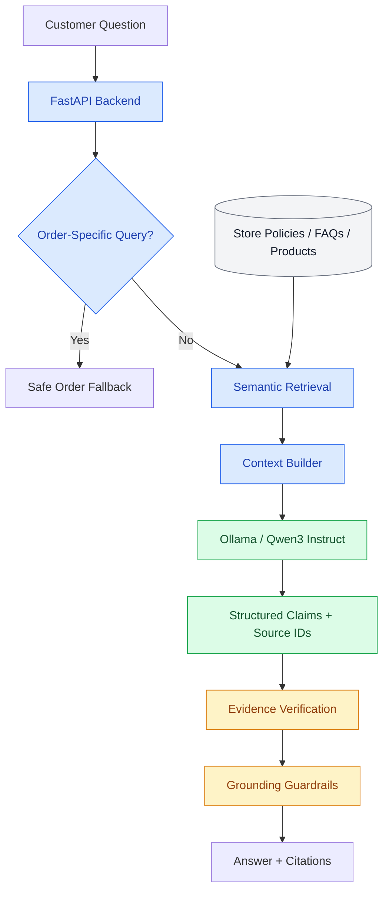

# AI Commerce Support Assistant

A local-first, RAG-powered ecommerce support assistant built with **FastAPI, Ollama, semantic retrieval, and evidence-based answer validation**.

The system retrieves relevant store knowledge, generates structured responses using a local language model, and validates supporting claims before returning customer-facing answers with source references.

## Overview

Ecommerce support requires more than retrieving FAQ answers. Customer questions often involve store policies, exceptions, incomplete information, and decisions that depend on verified business data.

This project explores a modular approach to AI-powered support, emphasizing grounded responses, source traceability, controlled fallbacks, and automated reliability testing.

The current implementation operates locally using a fictional ecommerce knowledge base and an Ollama-hosted language model.

## Architecture



Order-specific requests currently return a controlled fallback. Authenticated order lookups and ecommerce tool calling are not yet implemented.

## Technology Stack

| Component | Technology |
|---|---|
| Backend | Python, FastAPI |
| Local LLM | Ollama, Qwen3 4B Instruct |
| Embeddings | Sentence Transformers |
| Embedding Model | all-MiniLM-L6-v2 |
| Similarity Search | NumPy, cosine similarity |
| Knowledge Base | Markdown documents |
| Structured Generation | JSON Schema |
| Evidence Validation | Extractive claim verification |
| HTTP Client | HTTPX |
| Testing | Pytest |

Local inference does not require a paid LLM API. Public deployment and remote inference are not included in the current implementation.

## Features

### Semantic Knowledge Retrieval

Store knowledge is divided into sections using Markdown headings and converted into normalized 384-dimensional embeddings.

Customer queries are embedded using the same model, and knowledge sections are ranked by cosine similarity.

Each retrieval result includes its source document, section heading, chunk identifier, content, and similarity score.

### Local RAG Answer Generation

The assistant uses Ollama with `qwen3:4b-instruct` to generate answers from retrieved store knowledge.

Generation uses structured JSON containing an answer, individual factual claims, and source IDs.

The application handles unsupported questions through an explicit `insufficient_evidence` response.

### Evidence-Based Answer Validation

Generated claims are checked against their referenced knowledge sections before being included in the customer-facing response.

The current validation pipeline includes:

- JSON structure validation
- Source ID validation
- Extractive evidence matching
- Automatic citation generation
- Guardrails against selected unsupported commitments
- Controlled fallbacks when verification fails

Customer-facing answers are constructed from verified claims rather than directly returning the model's unrestricted answer.

Extractive verification is intentionally conservative. It does not establish full semantic entailment, resolve conflicting policies, or guarantee that every response is complete.

### Ecommerce Knowledge Base

The initial dataset represents **Northstar Goods**, a fictional outdoor equipment retailer.

It includes shipping, returns, refunds, cancellations, product specifications, warranties, and FAQs.

All store information is demonstration data.

### API Endpoints

**GET `/support/search`**

Returns semantically ranked knowledge sections.

Example:

```http
GET /support/search?q=How%20much%20does%20express%20shipping%20cost%3F&top_k=3
```

**POST `/support/ask`**

Retrieves supporting context and returns a grounded response.

Request:

```json
{
  "question": "How much does express shipping cost?"
}
```

Response:

```json
{
  "answer": "Express shipping costs €9.90. [shipping-3]",
  "sources": [
    {
      "id": "shipping-3",
      "source": "shipping.md",
      "heading": "Express Shipping",
      "score": 0.7877
    }
  ]
}
```

Source IDs identify the knowledge sections used to construct the answer. Similarity scores are retrieval metrics, not calibrated factual-confidence probabilities.

### Order Query Routing

The API detects selected order-specific questions and prevents the knowledge-only assistant from inventing order status or tracking information.

Order data access is not yet implemented, so these requests return a controlled fallback.

## Getting Started

### Requirements

- Python and pip
- Git
- Ollama
- `qwen3:4b-instruct` model

### Installation

Clone the repository:

```bash
git clone https://github.com/MausamThakrar/ai-commerce-support-assistant.git
cd ai-commerce-support-assistant

python3 -m venv .venv
source .venv/bin/activate

pip install -r requirements.txt
```

Install [Ollama](https://ollama.com/download) and download the language model:

```bash
ollama pull qwen3:4b-instruct
```

Make sure Ollama is running.

Create the environment configuration:

```bash
cp .env.example .env
```

Configuration:

```dotenv
OLLAMA_BASE_URL=http://localhost:11434
OLLAMA_MODEL=qwen3:4b-instruct
```

### Run the API

```bash
python -m uvicorn app.main:app --reload
```

API documentation: `http://127.0.0.1:8000/docs`

Health endpoint: `http://127.0.0.1:8000/health`

### Run Tests

```bash
python -m pytest -v
```

The current test suite contains **52 passing tests** covering retrieval, routing, structured generation, citation handling, evidence verification, and selected grounding and error-handling scenarios.

The repository also includes a manual real-model evaluation script:

```bash
python tests/manual_rag_evaluation.py
```

It exercises six representative customer questions against the running FastAPI and Ollama services and records response latency.

## Reliability & Evaluation

The system is designed to prioritize evidence-based responses over unsupported assertions.

Current validation covers malformed model output, invalid source references, missing evidence, selected unsupported refund commitments, and unknown order requests.

Further reliability work focuses on:

- Multi-turn customer conversations
- Conflicting and outdated policies
- Prompt injection and adversarial inputs
- Customer authorization and order-data isolation
- Partial fulfillments, cancellations, and refunds
- Semantic claim verification
- Large-scale retrieval accuracy and latency
- Controlled failures and service availability

The existing test results demonstrate the implemented behaviors, not production readiness.

## Scalability

The current knowledge base contains five Markdown documents and 36 indexed knowledge sections. Embeddings are held in memory.

The retrieval architecture will be evaluated against much larger document collections, including large individual files, with attention to token-aware chunking, persistent indexing, incremental updates, document versioning, and retrieval performance.

## Engineering Focus

- Retrieval-Augmented Generation
- Local LLM inference
- Semantic search and embeddings
- Structured output and context engineering
- Claim-level source traceability
- Evidence verification and AI guardrails
- FastAPI backend development
- Automated testing and real-model evaluation
- Ecommerce support workflow design

The broader objective is a reliable, extensible AI support architecture that can be connected to real ecommerce systems, including Shopify.