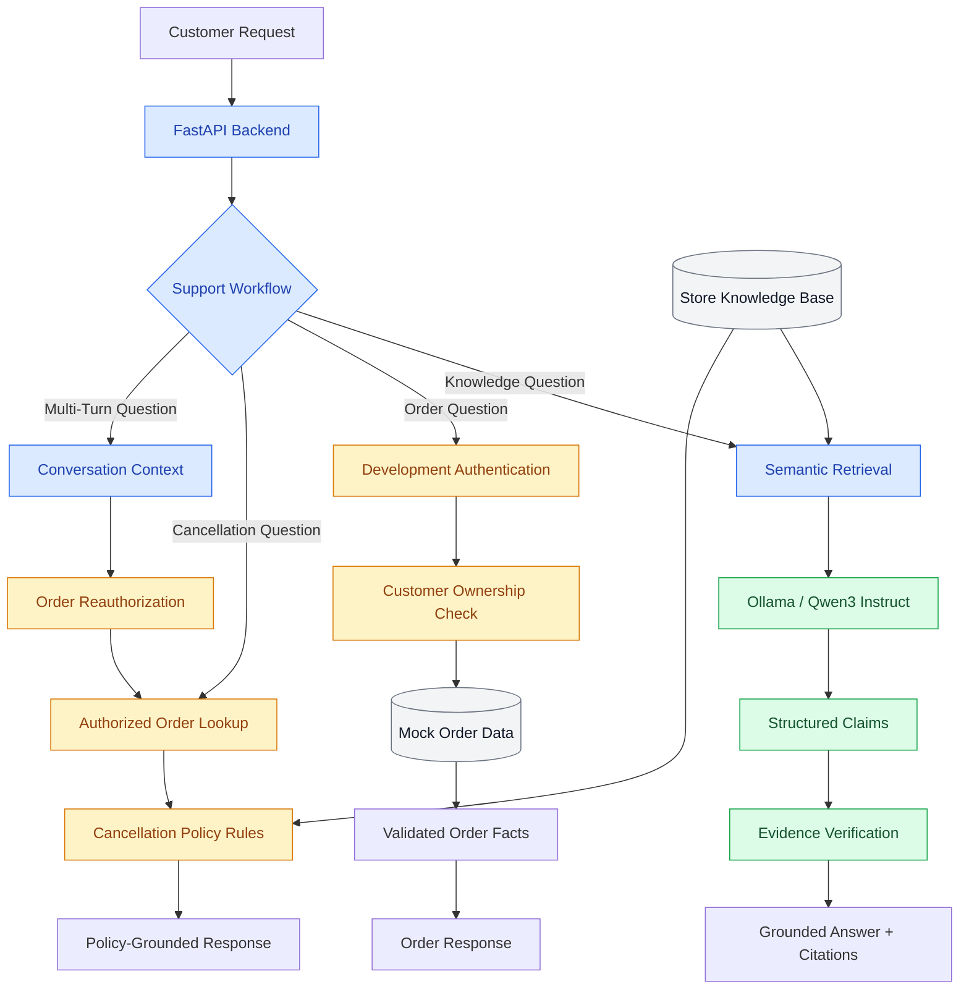

# AI Commerce Support Assistant

A local-first, AI-powered ecommerce support assistant built with **FastAPI, Ollama, semantic retrieval, and authenticated order workflows**.

The system combines Retrieval-Augmented Generation (RAG) with structured ecommerce data to answer customer questions about store policies, products, orders, fulfillment, and cancellations. It emphasizes source-grounded answers, customer data isolation, and controlled execution of read-only operations.

## Overview

Ecommerce support involves more than answering FAQs. Customer questions may require interpreting store policies, retrieving order information, handling partial fulfillments, and maintaining context across conversations.

This project explores a modular approach to these workflows, combining local LLM inference, evidence validation, backend-controlled order access, and automated reliability testing.

The implementation uses a fictional ecommerce store and runs locally without requiring a paid LLM API.

## Architecture



Knowledge questions use RAG with extractive claim validation. Order-specific questions use authenticated, read-only tools and deterministic response generation. Cancellation questions combine verified order information with cited store policies.

## Technology Stack

| Component | Technology |
|---|---|
| Backend | Python, FastAPI |
| Local LLM | Ollama, Qwen3 4B Instruct |
| Embeddings | Sentence Transformers, all-MiniLM-L6-v2 |
| Similarity Search | NumPy, cosine similarity |
| Knowledge Base | Markdown documents |
| Order Data | Structured JSON |
| Structured Generation | JSON Schema |
| Evidence Validation | Extractive claim verification |
| Authentication | Development-only session tokens |
| Conversation Context | In-memory, customer-scoped store |
| HTTP Client | HTTPX |
| Testing | Pytest |

## Features

### Semantic Knowledge Retrieval

Store knowledge is divided into sections using Markdown headings and converted into normalized 384-dimensional embeddings.

Customer queries are embedded using the same model, and relevant sections are ranked by cosine similarity.

Retrieval results include the source document, section heading, chunk identifier, text, and similarity score.

### Local RAG Answer Generation

The assistant uses Ollama with `qwen3:4b-instruct` to answer questions using retrieved knowledge.

Generation produces structured claims and source references. The backend validates the output and constructs customer-facing answers from extractively verified claims.

Unsupported questions receive a controlled fallback instead of fabricated store information.

Extractive matching is deliberately conservative and does not constitute full semantic verification.

### Authenticated Order Support

The order service provides read-only access to structured order records and validates customer ownership before returning information.

Supported scenarios include unfulfilled orders, delivered shipments, partial fulfillments, cancelled orders, and recorded refund statuses.

The backend validates order and shipment quantities to identify inconsistent fulfillment records.

Order IDs are resolved deterministically when explicitly provided. Ollama tool requests are restricted to an allowlisted read-only operation, and model-supplied customer identities are not trusted.

### Policy-Grounded Cancellation Support

Cancellation questions combine authenticated order facts with verified rules from the store's cancellation policy.

The system distinguishes shipped items from remaining unfulfilled quantities and references the relevant policy sections.

It does not assume that an unfulfilled item is automatically eligible for cancellation. When processing status is unavailable, the assistant explicitly states the limitation.

**Cancellations and refunds are never executed by the assistant.**

### Multi-Turn Order Conversations

The conversation endpoint maintains the most recently verified order reference across requests.

Customers can ask follow-up questions without repeating their order number. Each request revalidates order ownership against the authenticated customer.

Conversation context is customer-scoped, expires after a configurable period, and does not store full chat transcripts or order payloads.

### Ecommerce Knowledge Base

The demonstration store, **Northstar Goods**, is a fictional outdoor equipment retailer.

The knowledge base includes shipping, returns, refunds, cancellations, products, warranties, and FAQs.

Mock order records include multiple customers, fulfillment statuses, shipments, and partial fulfillment scenarios.

All store policies, customers, products, and orders are fictional demonstration data.

## API Endpoints

| Method | Endpoint | Purpose |
|---|---|---|
| GET | `/health` | API health check |
| GET | `/support/search` | Semantic knowledge retrieval |
| POST | `/support/ask` | RAG-based knowledge answers |
| GET | `/orders/{order_id}` | Authenticated order lookup |
| POST | `/support/order-ask` | Order-aware and policy-aware support |
| POST | `/support/order-chat` | Multi-turn order conversations |

The three order-specific endpoints are restricted to the local development environment.

### Knowledge-Based Question

**POST `/support/ask`**

```json
{
  "question": "How much does express shipping cost?"
}
```

Example response:

```json
{
  "answer": "Express shipping costs €9.90. [shipping-3]",
  "sources": [
    {
      "id": "shipping-3",
      "source": "shipping.md",
      "heading": "Express Shipping"
    }
  ]
}
```

### Order-Aware Question

**POST `/support/order-ask`**

Requires a development session token in the `Authorization: Bearer <token>` header.

```json
{
  "question": "Can I cancel the remaining item in ORD-1004?"
}
```

The response combines authorized order information with cancellation-policy evidence and includes source references. It does not perform any order modification.

### Multi-Turn Conversation

**POST `/support/order-chat`**

Initial request:

```json
{
  "question": "Where is ORD-1004?"
}
```

The response includes a `conversation_id`.

Follow-up request:

```json
{
  "question": "Can I cancel the remaining item?",
  "conversation_id": "<conversation-id-from-previous-response>"
}
```

The backend resolves the stored order reference and rechecks customer ownership before answering.

## Getting Started

### Requirements

- Python and pip
- Git
- Ollama
- `qwen3:4b-instruct` model

### Installation

```bash
git clone https://github.com/MausamThakrar/ai-commerce-support-assistant.git
cd ai-commerce-support-assistant

python3 -m venv .venv
source .venv/bin/activate

pip install -r requirements.txt
```

Install [Ollama](https://ollama.com/download) and download the model:

```bash
ollama pull qwen3:4b-instruct
```

Make sure Ollama is running.

Create the local configuration:

```bash
cp .env.example .env
```

The configuration includes:

```dotenv
OLLAMA_BASE_URL=http://localhost:11434
OLLAMA_MODEL=qwen3:4b-instruct

APP_ENV=development
DEMO_SESSION_100=
DEMO_SESSION_200=
```

Generate two separate development session tokens using Python's `secrets` module and add them to `.env`.

```bash
python -c "import secrets; print(secrets.token_urlsafe(32))"
```

Run the command separately for each customer.

Never commit actual session tokens. The `.env` file is excluded from version control.

### Run the API

```bash
python -m uvicorn app.main:app --reload
```

API documentation: `http://127.0.0.1:8000/docs`

Health endpoint: `http://127.0.0.1:8000/health`

### Run Tests

```bash
python -m pytest -v
```

The current implementation has **154 passing automated tests** covering retrieval, evidence verification, structured output, order ownership, fulfillment consistency, tool validation, authenticated APIs, conversation isolation, expiration, and adversarial scenarios.

A manual RAG evaluation script is also available:

```bash
python tests/manual_rag_evaluation.py
```

It evaluates representative questions against the running local model and API.

## Reliability & Security

The implementation incorporates several controls:

- Source validation and extractive verification for generated knowledge answers.
- Customer ownership checks for every order lookup.
- Consistent not-found behavior for unknown and unauthorized orders.
- Backend validation of tool names and arguments.
- No model-controlled customer identity or unrestricted order operations.
- No execution of cancellations, refunds, or other order modifications.
- Customer-scoped conversation context with expiration.
- Reauthorization of order references across conversation turns.
- Development-only restrictions on order-specific endpoints.

Automated tests also cover selected prompt-injection attempts, malformed tool requests, unauthorized access, and inconsistent order records.

These controls demonstrate the local architecture's tested behavior, not a comprehensive production security assessment.

## Scalability & Limitations

The current knowledge base contains five Markdown documents and 36 indexed sections. Embeddings are stored in memory, and order records are loaded from a local JSON dataset.

Conversation context is also stored in memory and is not shared across application workers or server restarts.

Cancellation-policy validation currently depends on expected rule wording and semantic retrieval of relevant knowledge sections.

Future engineering work includes persistent vector indexing, incremental knowledge updates, versioned policy rules, production authentication, larger-scale retrieval evaluation, and expanded conversational reasoning.

The application is a **local engineering demonstration**, not a production-ready Shopify support integration.

## Engineering Focus

- Retrieval-Augmented Generation and semantic search
- Local LLM inference and structured generation
- Evidence verification and source traceability
- Controlled tool calling and backend authorization
- Structured ecommerce order processing
- Policy-aware response generation
- Multi-turn conversation context
- Security boundaries and adversarial testing
- FastAPI architecture and automated evaluation

The longer-term goal is to extend the architecture toward real ecommerce integrations, including Shopify, while preserving reliable retrieval, controlled data access, and verifiable customer-facing responses.