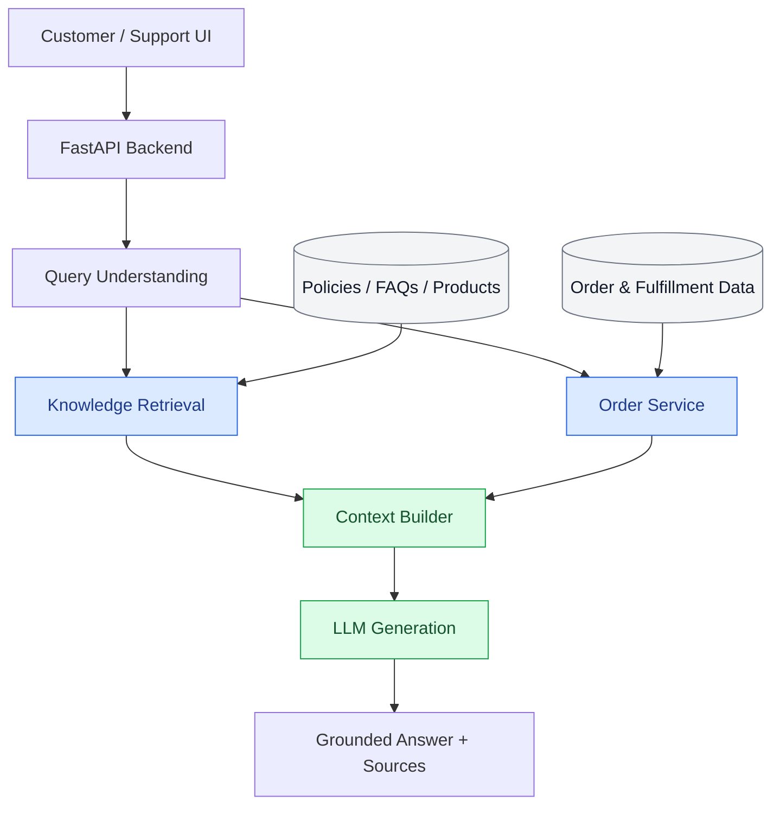

# AI Commerce Support Assistant

An AI-powered ecommerce customer support system designed around **Retrieval-Augmented Generation (RAG), semantic search, LLM tool calling, and order-aware support workflows**.

The project focuses on building a reliable, scalable support assistant that answers customer questions using store knowledge and structured ecommerce data, with emphasis on accuracy, traceability, and real-world reliability.

## Overview

Ecommerce support involves more than answering FAQs. Customer questions often require interpreting store policies, checking order information, understanding fulfillment states, and handling ambiguous or incomplete requests.

This project explores how AI can automate these workflows through knowledge retrieval, grounded response generation, controlled tool execution, and systematic evaluation.

The initial implementation provides semantic retrieval over a fictional ecommerce knowledge base.

## Architecture



The diagram represents the target architecture. Currently, document ingestion, embedding generation, semantic retrieval, and the FastAPI search endpoint are implemented.

## Technology Stack

| Component | Technology |
|---|---|
| Backend | Python, FastAPI |
| Embeddings | Sentence Transformers |
| Embedding Model | all-MiniLM-L6-v2 |
| Similarity Search | NumPy, cosine similarity |
| Knowledge Base | Markdown documents |
| API Validation | Pydantic / FastAPI |
| Testing | Pytest |
| LLM Integration | OpenAI Responses API (planned) |
| Frontend | Next.js, React, TypeScript (planned) |
| Deployment | Google Cloud Run, Vercel (planned) |

## Features

### Semantic Knowledge Retrieval

Ecommerce knowledge documents are divided into searchable sections using Markdown headings.

Each section is transformed into a normalized 384-dimensional vector embedding using `all-MiniLM-L6-v2`. Customer queries are embedded using the same model, and relevant sections are ranked through cosine similarity.

Results include the source document, section heading, knowledge chunk identifier, retrieved content, and similarity score.

### Ecommerce Knowledge Base

The initial dataset represents **Northstar Goods**, a fictional outdoor equipment retailer.

It contains shipping policies, return and refund rules, cancellation conditions, product specifications, warranties, and frequently asked questions.

All products, store policies, and business information are fictional demonstration data.

### Search API

**GET `/support/search`**

Example request:

```http
GET /support/search?q=How%20much%20does%20express%20shipping%20cost%3F&top_k=3
```

Example response (showing the highest-ranked result):

```json
{
  "query": "How much does express shipping cost?",
  "results": [
    {
      "id": "shipping-3",
      "source": "shipping.md",
      "heading": "Express Shipping",
      "text": "Express Shipping\nExpress shipping costs €9.90.\nEstimated delivery is 1–2 business days after dispatch.",
      "score": 0.7877
    }
  ]
}
```

The endpoint returns up to three results by default, configurable through `top_k`.

Similarity scores represent embedding similarity, not calibrated confidence probabilities.

### Automated Testing

The current implementation includes nine passing tests covering API health, semantic retrieval, empty-query behavior, result limits, and source metadata.

All five initial retrieval test questions returned the expected knowledge section at rank one. These tests establish a baseline but do not constitute a comprehensive retrieval benchmark.

## Local Development

### Prerequisites

- Python and pip
- Git

### Installation

```bash
git clone https://github.com/mausamthakrar/ai-commerce-support-assistant.git
cd ai-commerce-support-assistant

python3 -m venv .venv
source .venv/bin/activate

pip install -r requirements.txt
```

### Start the API

```bash
python -m uvicorn app.main:app --reload
```

API documentation: `http://127.0.0.1:8000/docs`

Health endpoint: `http://127.0.0.1:8000/health`

### Run Tests

```bash
python -m pytest -v
```

To fail tests on Python runtime warnings:

```bash
python -m pytest -W error::RuntimeWarning -v
```

## Reliability & Evaluation

The project places particular emphasis on validating AI behavior beyond straightforward FAQ responses.

The evaluation scope includes ambiguous customer questions, multiple simultaneous intents, missing or incorrect order information, conflicting policies, partially fulfilled orders, unauthorized data access, prompt injection, and external service failures.

The intended behavior is to rely on verified evidence, avoid fabricated information, preserve customer data boundaries, and use controlled fallbacks when an answer cannot be established.

These scenarios will be developed into automated evaluation datasets as the assistant gains its LLM and order-aware capabilities.

## Scalability

The initial retrieval implementation uses in-memory embeddings and a small Markdown knowledge base.

The system will also be tested against substantially larger document collections and files, with emphasis on token-aware chunking, persistent vector indexing, incremental ingestion, document freshness, retrieval quality, and performance under load.

## Engineering Focus

This project demonstrates practical AI engineering applied to ecommerce workflows, particularly:

- Retrieval-Augmented Generation and semantic search
- LLM integration and context engineering
- Controlled tool calling and ecommerce service integration
- Evidence-based response generation
- AI security and reliability testing
- Backend API development
- Retrieval evaluation and scalable data processing

The long-term objective is an adaptable AI support architecture for real ecommerce environments, including potential Shopify integrations.
